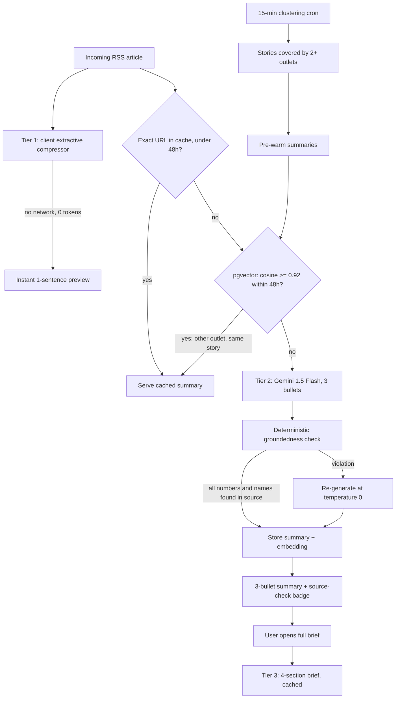

# RSSMindly

> RSS reader with cross-publisher semantic caching, tiered summaries, and a deterministic check that every number and name in a summary appears in the source article.

[](https://github.com/mmkaya-ui/rssmindly/actions/workflows/ci.yml)
[](https://vitejs.dev/)
[](https://react.dev/)
[](https://supabase.com/)
[](https://ai.google.dev/)
[](https://web.dev/progressive-web-apps/)
[](https://capacitorjs.com/)

---

## Demo

> **TODO: demo GIF not recorded yet.** Planned: add a feed, show the instant Tier 1 preview, open a second outlet's version of the same story (semantic cache hit), then the 3-bullet summary with its source-check badge. Save as `docs/demo.gif` and replace this block.

---

## The problem

When a story breaks, many outlets publish near-identical versions within minutes. A naive AI reader:

1. **Pays for the same summary repeatedly**: every distinct URL triggers a new LLM call.
2. **Makes the reader wait**: nothing is shown until the LLM responds.
3. **Trusts the model blindly**: invented prices or percentages go unchecked.
4. **Locks users into a subscription**: no way to bring your own key.

RSSMindly addresses each of these: semantic caching across outlets, an instant extractive preview, a deterministic source check, and bring-your-own-key.

---

## What the evidence shows (and doesn't)

All figures come from `npm run eval` and `npm test`; full output in [`evals/RESULTS.md`](evals/RESULTS.md). Be aware of what is simulated.

| Claim | Evidence | Status |
|---|---|---|
| Tier 1 preview is effectively instant | 0.054–0.066 ms/article across today's runs (production code, dev machine; varies per run) | **Measured** |
| Groundedness check catches injected errors (honest estimate) | Held-out set, 20 cases: 50% accuracy, 62.5% precision, 41.7% recall | **Measured**, AI-authored cases |
| Groundedness on the tuning set | Dev set, 30 cases: 83.3% → 100% accuracy after fixes | **Optimistic**: code was tuned on it |
| 0.92 is the right cosine threshold | Sweep is dominated by 0.80/0.81 on this data, *but* similarities come from a simulated embedder | **Unproven** |
| Semantic hits are fast and skip the LLM | Hit path makes no LLM call by construction; 42 ms / 240 ms latencies are `sleep()` values | **Latency simulated** |
| Cache saves tokens | 5/20 hits and 22.7% Tier 2 tokens saved in a replay with fixed token constants and the simulated embedder | **Modelled** |

> [!IMPORTANT]
> On the held-out set the current `groundedness.js` scores **lower** than the original (50% vs 60% accuracy). Three regressions came from the tuning: `Price` added to the stopword list hides real surnames (h06), currency normalisation lets `$500 million` match `€500 million` (h18), and single-digit checking flags `3` when the source says "Three" (h08). See [Limitations](#limitations).

---

## Architecture



---

## Design decisions and trade-offs

### Why a cosine threshold of 0.92?
Two headlines are embedded as 768-dim vectors; cosine similarity is the angle between them (1.0 = same direction), independent of headline length. The threshold trades two errors:

- **False positive (merge two different stories)**: the reader gets a summary of the wrong story, e.g. "Fed cuts rates" served for "Fed holds rates". Silent, and it persists for up to 48 h.
- **False negative (miss a duplicate)**: one extra LLM call. Costs money, but the output is correct.

Because false positives are much worse, 0.92 was picked as a deliberately high-precision value. **It has not been validated against the real model.** The sweep in `evals/RESULTS.md` currently runs on a simulated embedder, and even there 0.80/0.81 match 0.92's precision with higher recall. To validate, run `GOOGLE_GEMINI_API_KEY=... node evals/embed_pairs.js` once. That caches real `text-embedding-004` vectors, and the sweep re-runs offline on them. Note that production embeds headline + the first 150 body words, while the pairs set only has headlines.

### Why a deterministic check instead of LLM-as-judge?
- **No extra model call**: the check is regex and string matching in-process, so it adds no tokens and no network round trip.
- **Reproducible and auditable**: the same input always gives the same verdict, and each violation names the exact string that wasn't found.
- **No judge hallucinations**: an LLM judge can itself be wrong, and is not repeatable.

**The cost of this choice is coverage.** It only checks whether numbers and capitalised names appear in the source. It cannot see meaning: negation, swapped roles ("A acquired B" vs "B acquired A"), and numbers attached to the wrong metric all pass (held-out cases h04, h05, h14). It is a cheap first filter, not proof of faithfulness.

### Cost per 1,000 summaries
`evals/estimate_cost.js` measures the exact Tier 2 prompt (`buildTier2Prompt`) and estimates tokens as chars/4:

| Prompt | Est. input tokens |
|---|---|
| Fixture average (short articles) | 143 |
| Upper bound (500-char title + 4,000-char content cap) | 1,214 |

`cost_per_1k = 1000 × (1 − hit_rate) × (in_tokens × price_in + out_tokens × price_out) / 1e6`

Prices change, so none are hard-coded. Run `PRICE_IN_PER_M=… PRICE_OUT_PER_M=… OUTPUT_TOKENS=… CACHE_HIT_RATE=… node evals/estimate_cost.js` with current figures from [ai.google.dev/pricing](https://ai.google.dev/pricing). Output token counts and the real hit rate have not been measured; logging Gemini's `usageMetadata` in production would provide both.

### Cache invalidation: rolling 48 h
Both lookups (exact URL and `match_summaries`) only consider rows with `created_at >= now() − 48h`. News changes fast: corrections, follow-ups, a rate decision followed by its market reaction. A summary older than two days is more likely to be wrong than useful. After 48 h a row stops matching and the next request generates a fresh summary (and upserts over the old row for that URL). The trade-off: a story still developing on day three gets a new LLM call, even if nothing changed.

---

## Limitations

1. **Groundedness checker gaps**, all reproduced in the held-out set:
   - Meaning-level errors pass: negation, swapped roles, swapped attribution (h04, h05, h14).
   - Numbers at the end of a sentence (`2027.`) are skipped by the extractor, so a wrong year passes (h10).
   - Substring matching lets `150` pass when the source says `1500` (h11).
   - Currency symbols are stripped before comparison, so `$` vs `€` passes (h18).
   - Stopwords like `Price` hide real names (h06). Spelled-out numbers ("Three" vs `3`), hedged rounding and merged titles cause false alarms (h07, h08, h15).
2. **Threshold not validated** on real embeddings (see above).
3. **All eval data is AI-authored**: 60 headline pairs, 50 groundedness cases, 20 replay articles. Treat every metric as indicative until a human reviews the data.
4. **Headline-only dedup risk**: two articles with near-identical headlines but different later paragraphs share one summary.
5. **Rate limiting is per serverless instance** and keyed on `x-forwarded-for`, which only your hosting provider (e.g. Vercel) can be trusted to set. It is a basic abuse guard, not a quota system.
6. **Free-tier Gemini keys have rate limits**; heavy ingestion across many feeds can hit HTTP 429.

---

## Core Engineering Details

### 1. Cross-Publisher Semantic Cache (`api/lib/embedding.js`)
Instead of caching on brittle URL strings, headlines are mapped into 768-dimensional vector embeddings using Google's `text-embedding-004`.
* Stored in Supabase PostgreSQL using `pgvector` with an **HNSW cosine index** (`vector_cosine_ops`, `m = 16`, `ef_construction = 64`).
* A match threshold of **0.92** lets competing headlines covering the same news cycle share a summary (see trade-offs above).
* Queries look back over a rolling 48-hour window so stale news cycles age out.

### 2. Cascading Multi-Tier Summarization (`api/summarize.js`)
* **Tier 1 (instant micro-summary, 0 tokens):** A rule-based extractive compressor scores headline salience, lead paragraphs, and sentence boundaries in browser memory. It renders immediately while network requests are in flight.
* **Tier 2 (3-bullet summary, Gemini 1.5 Flash):** Generates 3 high-density bullets (catalyst, confirmed metrics, market impact).
* **Tier 3 (on-demand long-form brief):** When the user clicks **`📖 View Full Brief`**, an analytical agent generates a structured 4-part dossier:
  1. *Executive Overview & Key Developments*
  2. *Detailed Background, Context & Key Statements*
  3. *Key Metrics & Confirmed Figures (verbatim extraction)*
  4. *Strategic Industry & Future Outlook*
  Cached in `tier3_deepdive` for 0-token recall across sessions.

### 3. Predictive Pre-Warming via Multi-Feed Clustering (`api/prewarm.js`)
A background cron worker runs every 15 minutes:
* Fetches the latest articles across all configured feeds.
* Runs token-overlap and bag-of-words clustering across headlines.
* If **2 or more distinct publishers** report on the same topic, the story is classified as trending.
* Pre-populates Tier 1 and Tier 2 summaries into pgvector before users open the app.
* *Guardrail:* Defaults to dry-run unless `ENABLE_PREWARMING=true` is set.

### 4. Deterministic Groundedness Check (`api/lib/groundedness.js`)
Rather than relying only on prompt instructions like *"do not hallucinate"*, every generated summary is checked:
* Extracts currency values (`$1,599`, `€500 million`), multipliers (`3.5x`), percentages (`54%`), standalone numbers, and capitalised names from the summary. Currency symbols are written as `\u` escapes so the regex doesn't depend on file encoding.
* Normalises formatting (commas, currency words) and looks each item up in the source text.
* Any violation triggers a zero-temperature (`temperature: 0.0`) re-generation with stricter instructions.
* Limits are listed under [Limitations](#limitations).

---

## Privacy & BYOK (Bring Your Own Key)

RSSMindly is designed to be free and open:

* **Free Tier (BYOK):** Users input their free Google Gemini API key from [Google AI Studio](https://aistudio.google.com/app/apikey).
* **Zero Telemetry:** Keys are stored in `localStorage` in the user's browser. If the backend server is unreachable, the client falls back to direct browser-to-Gemini requests.
* **Pro Mode:** Server-side environment variables (`GOOGLE_GEMINI_API_KEY`, `SUPABASE_URL`, `SUPABASE_KEY`) allow centralized managed hosting for teams.

### Server-side handling (`api/summarize.js`)
* A `clientApiKey` sent in the request body is used only in memory to create the Gemini client. It is not written to Supabase, and every log/error path passes through `redactSecrets()` (client key and server keys).
* Request guards: string-type checks on all fields; URL ≤ 2,048 chars, title ≤ 500, content ≤ 50,000 (HTTP 413 above that); 60 requests/minute per IP (HTTP 429). Covered by `test/api.test.js`.

---

## Multi-Platform: PWA (A2HS) & Native Android

* **PWA (Add to Home Screen):**
  * Fully configured [`public/manifest.json`](public/manifest.json) with `display: "standalone"`.
  * iOS Safari meta tags (`apple-mobile-web-app-capable: yes`, `viewport-fit=cover`) deliver a fullscreen app experience respecting iPhone notches and gesture bars.
* **Capacitor 7 Native Android:**
  * Complete Android Studio project located in `/android`.
  * Build native `.apk` files using `npx cap sync` and `npx cap open android`.

---

## Supabase Database Schema

Run this in your **Supabase SQL Editor**:

```sql
-- 1. Enable pgvector
CREATE EXTENSION IF NOT EXISTS vector;

-- 2. Summaries table with embeddings & verification metadata
CREATE TABLE IF NOT EXISTS summaries (
    id UUID PRIMARY KEY DEFAULT gen_random_uuid(),
    url TEXT UNIQUE NOT NULL,
    title TEXT,
    source TEXT,
    headline_embedding VECTOR(768),
    tier1_micro TEXT,
    tier2_bullets TEXT,
    tier3_deepdive TEXT,
    text TEXT NOT NULL,
    groundedness_score FLOAT DEFAULT 1.0,
    groundedness_report JSONB DEFAULT '{}'::jsonb,
    cluster_id TEXT,
    hit_count INT DEFAULT 1,
    created_at TIMESTAMPTZ DEFAULT now(),
    updated_at TIMESTAMPTZ DEFAULT now()
);

-- 3. HNSW cosine index for fast vector searches
CREATE INDEX IF NOT EXISTS idx_summaries_embedding_hnsw 
ON summaries USING hnsw (headline_embedding vector_cosine_ops)
WITH (m = 16, ef_construction = 64);

-- 4. Stored procedure for semantic search
CREATE OR REPLACE FUNCTION match_summaries (
    query_embedding VECTOR(768),
    match_threshold FLOAT DEFAULT 0.92,
    match_count INT DEFAULT 1,
    max_age_hours INT DEFAULT 48
)
RETURNS TABLE (
    id UUID, url TEXT, title TEXT, source TEXT, text TEXT,
    tier1_micro TEXT, tier2_bullets TEXT, tier3_deepdive TEXT,
    groundedness_score FLOAT, groundedness_report JSONB,
    similarity FLOAT, created_at TIMESTAMPTZ
)
LANGUAGE plpgsql
AS $$
BEGIN
    RETURN QUERY
    SELECT
        s.id, s.url, s.title, s.source, s.text,
        s.tier1_micro, s.tier2_bullets, s.tier3_deepdive,
        s.groundedness_score, s.groundedness_report,
        (1 - (s.headline_embedding <=> query_embedding))::FLOAT AS similarity,
        s.created_at
    FROM summaries s
    WHERE s.headline_embedding IS NOT NULL
      AND s.created_at >= (NOW() - (max_age_hours || ' hours')::INTERVAL)
      AND (1 - (s.headline_embedding <=> query_embedding)) >= match_threshold
    ORDER BY s.headline_embedding <=> query_embedding ASC
    LIMIT match_count;
END;
$$;
```

---

## Local Development & Testing

### 1. Clone & Install
```bash
git clone https://github.com/mmkaya-ui/rssmindly.git
cd rssmindly
npm install
```

### 2. Run Automated Tests (0 tokens spent)
```bash
npm test
```
Runs `test/unit.test.js` (36 checks: cosine edge cases, clustering with bad dates, number/currency extraction), `test/api.test.js` (15 checks: type checks, size limits, rate limiting, redaction) and `scripts/test-semantic-pipeline.js` (15 checks).

### 3. Run the Offline Evaluation Harness
```bash
npm run eval
```
Threshold sweep, groundedness (dev + held-out, baseline vs current), feed replay, and token estimate. No keys or network needed. Writes [`evals/RESULTS.md`](evals/RESULTS.md) and exits non-zero if a regression floor is breached (CI runs this).

Optional, one-off with a key, to replace the simulated embedder with real vectors:
```bash
GOOGLE_GEMINI_API_KEY=... node evals/embed_pairs.js
```

### 4. Run Live Multi-Feed Benchmark
```bash
node scripts/run-live-feed-test.js
```
Fetches real articles from BBC Tech, TechCrunch, and Hacker News and outputs latency, clustering, and deduplication statistics.

### 5. Start Development Server
```bash
npm run dev
```

### 6. Build for Production
```bash
npm run build
```

---

## Documentation & Guides

* 📖 **[User Manual & Complete Guide](docs/USER_MANUAL.md):** In-depth user manual covering feed addition, folder bundles, daily AI digest generation, reader mode (`smry.ai`), and mobile PWA installation.
* 📊 **[Evaluation Results](evals/RESULTS.md):** Full eval output, including every false positive and false negative.
* 💡 **In-App Tutorial:** Click the **User Guide** button directly in the app header or sidebar to open the interactive walkthrough.

---

## License

MIT License. Free for personal and commercial use.
