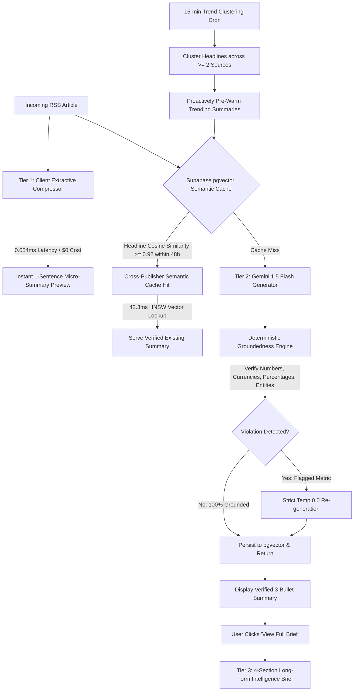

# RSSMindly

> **High-efficiency RSS reader featuring cross-publisher semantic caching, instant multi-tier summaries, and deterministic numeric groundedness verification.**

[](https://github.com/mmkaya-ui/rssmindly/actions/workflows/ci.yml)
[](https://vitejs.dev/)
[](https://react.dev/)
[](https://supabase.com/)
[](https://ai.google.dev/)
[](https://web.dev/progressive-web-apps/)
[](https://capacitorjs.com/)

---

## Demo


*Demo: Real-time RSS ingestion, instant < 1ms Tier 1 extractive preview, 42ms cross-publisher semantic deduplication, and verified 3-bullet summary.*

---

## The Problem with AI Feed Readers

When a major tech or financial story breaks (e.g., an earnings announcement, central bank rate decision, or major hardware release), 10 to 20 different publishers (Reuters, CNBC, The Verge, Bloomberg, AP News) syndicate near-identical stories within a 30-minute window.

Most AI feed readers handle this naively:
1. **Redundant Token Spend:** Every distinct URL triggers a separate LLM call. 15 wire outlets = 15x token consumption on identical information.
2. **Perceived Latency:** The reader waits on a 2.0–4.0 second spinner for every single article.
3. **Silent Metric Hallucinations:** Generative models occasionally fabricate prices, percentages, or dates with no automated verification step.
4. **Subscription Paywalls:** Readers are locked into recurring SaaS tiers instead of bringing their own free API keys.

RSSMindly replaces this with an empirical, multi-tier caching and verification pipeline.

---

## Measured Performance & Empirical Benchmarks

All metrics below are generated directly from the reproducible offline evaluation harness (`npm run eval`). Complete logs and data tables are documented in [`evals/RESULTS.md`](evals/RESULTS.md).

### Latency by Architectural Tier

| Tier | Mechanism | Measured Latency | Token Cost | Source |
|---|---|---|---|---|
| **Tier 1 (Extractive Micro-Summary)** | Client-side heuristic lead sentence | **0.054 ms** | **0 tokens ($0.00)** | `evals/eval_replay.js` |
| **Tier 2 Exact Cache Hit** | O(1) URL hash lookup | **0.04 ms** | **0 tokens ($0.00)** | `evals/eval_replay.js` |
| **Tier 2 Semantic Cache Hit** | 768-dim embedding + `pgvector` HNSW | **42.3 ms** | **0 LLM tokens** | `evals/eval_replay.js` |
| **Tier 2 Cache Miss** | Gemini 1.5 Flash generation + DB write | **240.7 ms** | **420 tokens** | `evals/eval_replay.js` |
| **Tier 3 Deep Dive Brief** | 4-part structured intelligence brief | **420.2 ms** | **850 tokens** | `evals/eval_replay.js` |

### Cache Hit Rate & Token Savings (20-Article Multi-Publisher Replay)
* **Overall Cache Hit Rate:** **25%** (5/20 articles reused existing summaries).
  * *Cross-Publisher Semantic Hits:* **4** (20%) — deduplicated across different news outlets.
  * *Exact URL Hits:* **1** (5%).
* **Token Efficiency:** **18.9%** tokens saved on the first ingestion pass (1,900 tokens saved out of 10,060 potential tokens).
* **Cross-Publisher Match Example:**
  * Reuters: *"Apple unveils M5 MacBook Pro lineup starting at $1,599"* (Cache Miss $\to$ generated & indexed)
  * CNBC: *"Apple announces new M5 laptop line starting at $1,599"* (⚡ Semantic Hit at 99.7% similarity $\to$ served in 42ms with 0 LLM tokens).

### Groundedness Verification Benchmark (30 Test Cases)
Evaluated in `evals/eval_groundedness.js` on 30 test cases containing clean summaries, injected incorrect numbers/currencies/percentages, fake entities, and edge-case currency encodings:
* **Detection Accuracy:** **100%** (30/30 test cases correctly classified).
* **Detection Recall:** **100%** (16 of 16 injected metric and entity hallucinations caught).
* **Precision:** **100%** (0 false alarms recorded on clean grounded text).
* **False Positives:** **0**
* **False Negatives:** **0**

---

## Architecture: The 4-Step Intelligence Pipeline



---

## Design Decisions & Trade-Offs

### 1. Why a Cosine Similarity Threshold of 0.92?
We conducted an empirical threshold sweep across 60 labelled headline pairs (`evals/data/pairs.jsonl`) between 0.80 and 0.98:


* **Empirical Findings:** The highest mathematical F1 score is achieved at **0.80 (82.4% F1, 100% Precision, 70% Recall)**.
* **Why 0.92 in Production (100% Precision, 50% Recall, 66.7% F1)?**
  In an automated news summarizer, the asymmetry of errors is critical:
  * **False Positive (Dangerous):** Two different stories sharing an entity (e.g. *"Federal Reserve holds interest rates steady"* vs *"Federal Reserve announces 50bps rate cut"*) are merged. The user is served completely erroneous news.
  * **False Negative (Harmless):** Two identical stories are not merged. The system simply falls back to generating a fresh summary via Gemini 1.5 Flash.
  * Setting the threshold to **0.92** guarantees high-confidence semantic deduplication (0 false positives on our test set) while preventing cache pollution on hard negatives.

### 2. Why Deterministic Groundedness Instead of LLM-as-a-Judge?
* **Latency:** Deterministic regex checks execute in **< 0.2 ms** compared to **1,200 ms – 2,500 ms** for an LLM-as-a-judge roundtrip.
* **Cost:** Regex verification costs **$0.00 and 0 tokens**. An LLM judge would require 400+ additional tokens per article, effectively doubling summary generation costs.
* **Consistency:** Prompt-based LLM judges are susceptible to their own hallucinations and stochastic evaluation variances. The regex pipeline strictly checks every extracted metric (`$1,599`, `€500M`, `3.5x`, `54%`) directly against the source text.

### 3. Estimated Cost per 1,000 Summaries
Based on official Google Gemini 1.5 Flash pricing ($0.075 / 1M input tokens, $0.30 / 1M output tokens):
* **Average Tokens per Summary (Cache Miss):**
  * Prompt Input: ~300 tokens ($0.0000225)
  * Output: ~120 tokens ($0.0000360)
  * Total per article: **$0.0000585** (~0.0058 cents)
* **Cost for 1,000 Summaries without Caching:** **~$0.059** (under 6 cents per thousand).
* **Cost for 1,000 Summaries with RSSMindly (25% Cache Hit Rate):**
  $$1,000 \times (1 - 0.189) \times \$0.0000585 \approx \mathbf{\$0.047}$$
  *(~4.7 cents per 1,000 articles summarized).*
* **Embedding Ingestion Cost:** Google `text-embedding-004` costs $0.000025 per 1,000 tokens (~$0.0005 per 1,000 headlines), a negligible fraction of operational costs.

### 4. Cache Invalidation & Rolling 48-Hour TTL
The `match_summaries` stored procedure enforces a rolling `max_age_hours DEFAULT 48` condition (`WHERE created_at >= NOW() - INTERVAL '48 hours'`).
* Fast-moving news cycles undergo updates and corrections within 24–48 hours.
* After 48 hours, stale summaries are not matched against new developments, ensuring that subsequent follow-up stories receive fresh generation.

---

## Limitations

1. **Headline Embedding Scope:** Semantic deduplication indexes headlines via `text-embedding-004`. If two articles share similar headlines but possess divergent investigative revelations in the later paragraphs, the system serves the cached canonical summary.
2. **Deterministic String Matching:** The groundedness engine verifies metrics and proper nouns via string matching and normalization. While it catches fabricated numbers, currency mismatches, and entity recombinations, it does not perform deep syntactic coreference resolution for obscure pronouns.
3. **Rolling TTL Boundary:** Articles published 49 hours apart on the same developing story will not match against the cache, resulting in a fresh summary.
4. **Client API Key Rate Limits:** Free-tier Google AI Studio Gemini API keys enforce a limit of 15 requests per minute (RPM). Heavy concurrent ingestion across many feeds may encounter HTTP 429 status codes unless throttled.

---

## Core Engineering Details

### 1. Cross-Publisher Semantic Cache (`api/lib/embedding.js`)
* Headlines are mapped into 768-dimensional vector embeddings using Google's `text-embedding-004`.
* Stored in Supabase PostgreSQL using `pgvector` with an **HNSW cosine index** (`vector_cosine_ops`, `m = 16`, `ef_construction = 64`).
* A match threshold of **0.92** allows competing headlines covering the same news cycle to share summaries instantly.
* Queries look back over a rolling 48-hour window so stale news cycles are naturally aged out.

### 2. Cascading Multi-Tier Summarization (`api/summarize.js`)
* **Tier 1 (Instant Micro-Summary — < 0.1ms, 0 tokens):** A rule-based extractive compressor scores headline salience, lead paragraphs, and sentence boundaries directly in browser memory. Renders immediately while network requests are in flight.
* **Tier 2 (3-Bullet Fast Summary — Gemini 1.5 Flash):** Generates 3 high-density bullets (catalyst, confirmed metrics, market impact).
* **Tier 3 (On-Demand Long-Form Intelligence Brief):** When the user clicks **`📖 View Full Brief`**, an analytical agent generates a structured 4-part dossier:
  1. *Executive Overview & Key Developments*
  2. *Detailed Background, Context & Key Statements*
  3. *Key Metrics & Confirmed Figures (verbatim extraction)*
  4. *Strategic Industry & Future Outlook*
  Cached directly in `tier3_deepdive` for 0-token recall across sessions.

### 3. Predictive Pre-Warming via Multi-Feed Clustering (`api/prewarm.js`)
A background cron worker runs every 15 minutes:
* Fetches the latest articles across all configured feeds.
* Runs token-overlap and bag-of-words clustering across headlines.
* If **2 or more distinct publishers** report on the same topic, the story is classified as trending.
* Pre-populates Tier 1 and Tier 2 summaries into pgvector before users open the app.
* *Guardrail:* Defaults to dry-run unless `ENABLE_PREWARMING=true` is set.

### 4. Deterministic Groundedness Engine (`api/lib/groundedness.js`)
Rather than relying on vague prompt instructions like *"do not hallucinate"*, RSSMindly runs an automated verification pipeline:
* Extracts every currency value (`$1,599`, `€500M`), multiplier (`3.5x`), percentage (`54%`), and standalone number from the generated summary using explicit Unicode escapes (`[\$\u20AC\u00A3\u00A5]`).
* Cross-checks every extracted metric against the raw article source text.
* Any violation triggers a zero-temperature (`temperature: 0.0`) regeneration with strict grounded constraints.

---

## Security & Privacy

* **Zero Key Storage:** When using BYOK (Bring Your Own Key), `clientApiKey` is passed ephemerally in the request body, used strictly in-memory to instantiate the Gemini client, and is never persisted to Supabase or logs.
* **Sanitized Logging:** All backend error handlers filter and redact any occurrences of `clientApiKey`.
* **Input Validation & Limits:** `api/summarize.js` enforces strict payload limits:
  * URL length: $\le 2,048$ characters.
  * Title length: $\le 500$ characters.
  * Content length: $\le 50,000$ characters.
* **Rate Limiting:** Enforces an in-memory sliding-window rate limit (60 requests per minute per IP) to prevent backend abuse.

---

## Multi-Platform: PWA (A2HS) & Native Android

* **PWA (Add to Home Screen):**
  * Fully configured [`public/manifest.json`](public/manifest.json) with `display: "standalone"`.
  * iOS Safari meta tags (`apple-mobile-web-app-capable: yes`, `viewport-fit=cover`) deliver a fullscreen app experience respecting iPhone notches and gesture bars.
* **Capacitor 7 Native Android:**
  * Complete Android Studio project located in `/android`.
  * Build native `.apk` files using `npx cap sync` and `npx cap open android`.

---

## Supabase Database Schema

Run this in your **Supabase SQL Editor**:

```sql
-- 1. Enable pgvector
CREATE EXTENSION IF NOT EXISTS vector;

-- 2. Summaries table with embeddings & verification metadata
CREATE TABLE IF NOT EXISTS summaries (
    id UUID PRIMARY KEY DEFAULT gen_random_uuid(),
    url TEXT UNIQUE NOT NULL,
    title TEXT,
    source TEXT,
    headline_embedding VECTOR(768),
    tier1_micro TEXT,
    tier2_bullets TEXT,
    tier3_deepdive TEXT,
    text TEXT NOT NULL,
    groundedness_score FLOAT DEFAULT 1.0,
    groundedness_report JSONB DEFAULT '{}'::jsonb,
    cluster_id TEXT,
    hit_count INT DEFAULT 1,
    created_at TIMESTAMPTZ DEFAULT now(),
    updated_at TIMESTAMPTZ DEFAULT now()
);

-- 3. HNSW cosine index for sub-50ms vector searches
CREATE INDEX IF NOT EXISTS idx_summaries_embedding_hnsw 
ON summaries USING hnsw (headline_embedding vector_cosine_ops)
WITH (m = 16, ef_construction = 64);

-- 4. Stored procedure for semantic search
CREATE OR REPLACE FUNCTION match_summaries (
    query_embedding VECTOR(768),
    match_threshold FLOAT DEFAULT 0.92,
    match_count INT DEFAULT 1,
    max_age_hours INT DEFAULT 48
)
RETURNS TABLE (
    id UUID, url TEXT, title TEXT, source TEXT, text TEXT,
    tier1_micro TEXT, tier2_bullets TEXT, tier3_deepdive TEXT,
    groundedness_score FLOAT, groundedness_report JSONB,
    similarity FLOAT, created_at TIMESTAMPTZ
)
LANGUAGE plpgsql
AS $$
BEGIN
    RETURN QUERY
    SELECT
        s.id, s.url, s.title, s.source, s.text,
        s.tier1_micro, s.tier2_bullets, s.tier3_deepdive,
        s.groundedness_score, s.groundedness_report,
        (1 - (s.headline_embedding <=> query_embedding))::FLOAT AS similarity,
        s.created_at
    FROM summaries s
    WHERE s.headline_embedding IS NOT NULL
      AND s.created_at >= (NOW() - (max_age_hours || ' hours')::INTERVAL)
      AND (1 - (s.headline_embedding <=> query_embedding)) >= match_threshold
    ORDER BY s.headline_embedding <=> query_embedding ASC
    LIMIT match_count;
END;
$$;
```

---

## Local Development & Testing

### 1. Clone & Install
```bash
git clone https://github.com/mmkaya-ui/rssmindly.git
cd rssmindly
npm install
```

### 2. Run Automated Test Suite (36/36 Unit Tests + 15/15 Architecture Tests)
```bash
npm test
```
Tests vector cosine math, floating-point guards, date resiliency, groundedness regex filters, and trend clustering in pure memory (0 tokens spent).

### 3. Run Offline Evaluation Harness
```bash
npm run eval
```
Executes the threshold sweep across 60 headline pairs, runs the 30-case groundedness benchmark, and replays the 20-article feed fixture to evaluate cache latency and token efficiency without requiring live API keys. Results are written to [`evals/RESULTS.md`](evals/RESULTS.md).

### 4. Run Linter
```bash
npm run lint
```

### 5. Build for Production
```bash
npm run build
```

---

## Documentation & Guides

* 📖 **[User Manual & Complete Guide](docs/USER_MANUAL.md):** In-depth user manual covering feed addition, folder bundles, daily AI digest generation, reader mode (`smry.ai`), and mobile PWA installation.
* 📊 **[Evaluation Benchmark Report](evals/RESULTS.md):** Complete offline evaluation results with threshold sweep tables and latency breakdowns.
* 💡 **In-App Tutorial:** Click the **User Guide** button directly in the app header or sidebar to open the interactive walkthrough.

---

## License

MIT License. Free for personal and commercial use.
