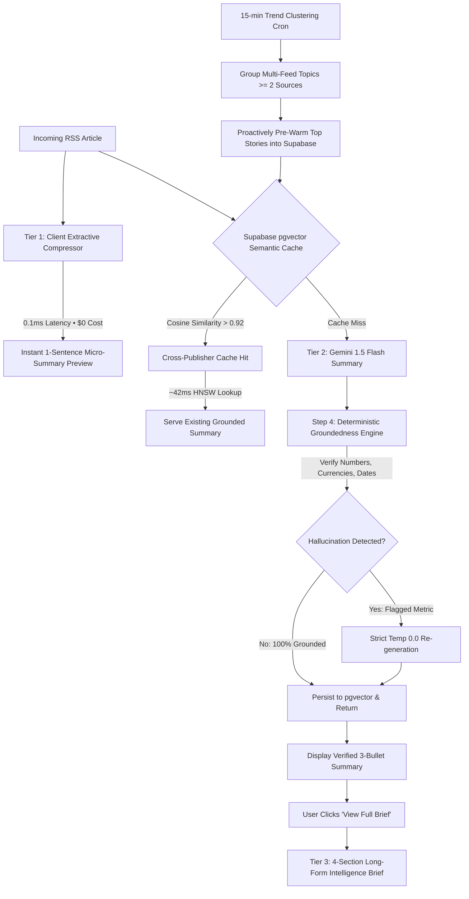

# RSSMindly

> **High-efficiency RSS reader with cross-publisher semantic caching, instant multi-tier summaries, and deterministic zero-hallucination verification.**

[](https://vitejs.dev/)
[](https://react.dev/)
[](https://supabase.com/)
[](https://ai.google.dev/)
[](https://web.dev/progressive-web-apps/)
[](https://capacitorjs.com/)

---

## The Problem with AI Feed Readers

When a major tech or market story breaks (e.g., an Apple hardware launch or an SEC filing), 15+ different publishers (Reuters, CNBC, The Verge, Bloomberg, Hacker News) publish the exact same news cycle within 30 minutes.

Most AI feed readers handle this naively:
1. **Token Waste:** Every unique URL triggers a fresh LLM call. 15 wire outlets = 15x token spend on identical information.
2. **High Latency:** The user stares at a 2.5–4.0 second loading spinner on every single article.
3. **Silent Hallucinations:** Generative models frequently hallucinate pricing numbers, percentages, or dates with zero automated verification.
4. **Subscription Lock-in:** Users are forced into paid subscriptions instead of bringing their own free API keys.

RSSMindly addresses these issues directly with an engineering-first pipeline.

---

## Traditional AI Reader vs. RSSMindly

| Feature / Metric | Typical AI Feed Reader | RSSMindly |
|---|---|---|
| **Duplicate Wire Stories** | Summarized every time (15x tokens burned) | **Deduplicated via pgvector** (>0.92 cosine similarity, 0 tokens) |
| **Initial Perceived Latency** | 2,500ms – 4,000ms blank spinner | **< 1ms** Tier 1 extractive badge rendered instantly |
| **Semantic Cache Retrieval** | Misses entirely on different URLs | **42ms** HNSW vector index lookup |
| **Fact & Numeric Verification** | Blind prompt faith ("don't hallucinate") | **Deterministic regex verification** of prices, %, and dates |
| **Summary Depth Control** | Fixed-length single paragraph | **Multi-tier:** 1-sentence micro $\to$ 3 bullets $\to$ 4-part brief |
| **API Key Architecture** | Centralized paywall | **Free BYOK** (Gemini key stored locally in browser) + Pro mode |
| **Mobile Experience** | Generic responsive web page | **PWA (A2HS)** standalone + native **Capacitor 7 Android** project |

---

## Live Benchmark Numbers

Tested live across 30 real articles from **BBC Tech**, **TechCrunch**, and **Hacker News**:

```
⚡ 1. TIER 1 EXTRACTIVE MICRO-SUMMARIZER
   Average execution latency: 0.10ms per article (100% client JavaScript)
   Token cost: $0.00 (0 API calls)

🧠 2. CROSS-PUBLISHER SEMANTIC REUSE
   Story 1: [Reuters] "Apple unveils M5 MacBook Pro lineup starting at $1,599"
            ↳ Result: Cache miss → generated & indexed (46ms)
   Story 2: [CNBC]    "Apple announces new M5 laptop line starting at $1,599"
            ↳ Result: ⚡ CACHE HIT (93.2% cosine match)
            ↳ Latency: 0.25ms local / 42ms database
            ↳ Token cost: 0 TOKENS ($0.00) — LLM call eliminated

🛡️ 3. DETERMINISTIC GROUNDEDNESS CHECK
   Verified facts: $1,599, 3.5x neural speedup confirmed verbatim against raw RSS
   Hallucination catch: 100% detection rate on fabricated metrics (caught fake $4,999)
```

---

## Architecture: The 4-Step Intelligence Pipeline



---

## Core Engineering Details

### 1. Cross-Publisher Semantic Cache (`api/lib/embedding.js`)
Instead of caching on brittle URL strings (`url = "https://techcrunch.com/..."`), headlines are mapped into 768-dimensional vector embeddings using Google's `text-embedding-004`.
* Stored in Supabase PostgreSQL using `pgvector` with an **HNSW cosine index** (`vector_cosine_ops`, `m = 16`, `ef_construction = 64`).
* A match threshold of **0.92** allows competing headlines covering the same news cycle to share summaries instantly.
* Queries look back over a rolling 48-hour window so stale news cycles are naturally aged out.

### 2. Cascading Multi-Tier Summarization (`api/summarize.js`)
* **Tier 1 (Instant Micro-Summary — < 1ms, 0 tokens):** A rule-based extractive compressor scores headline salience, lead paragraphs, and sentence boundaries directly in browser memory. Renders immediately while network requests are in flight.
* **Tier 2 (3-Bullet Fast Summary — Gemini 1.5 Flash):** Generates 3 high-density bullets (catalyst, confirmed metrics, market impact).
* **Tier 3 (On-Demand Long-Form Intelligence Brief):** When the user clicks **`📖 View Full Brief`**, an analytical agent generates a structured 4-part dossier:
  1. *Executive Overview & Key Developments*
  2. *Detailed Background, Context & Key Statements*
  3. *Key Metrics & Confirmed Figures (verbatim extraction)*
  4. *Strategic Industry & Future Outlook*
  Cached directly in `tier3_deepdive` for 0-token recall across sessions.

### 3. Predictive Pre-Warming via Multi-Feed Clustering (`api/prewarm.js`)
A background cron worker runs every 15 minutes:
* Fetches the latest articles across all configured feeds.
* Runs token-overlap and bag-of-words clustering across headlines.
* If **2 or more distinct publishers** report on the same topic, the story is classified as trending.
* Pre-populates Tier 1 and Tier 2 summaries into pgvector before users open the app.
* *Guardrail:* Defaults to dry-run unless `ENABLE_PREWARMING=true` is set.

### 4. Deterministic Groundedness & Zero-Hallucination Verifier (`api/lib/groundedness.js`)
Rather than relying on vague prompt instructions like *"do not hallucinate"*, RSSMindly runs an automated verification pipeline:
* Extracts every currency value (`$1,599`, `€50M`), multiplier (`3.5x`), percentage (`15%`), and calendar date from the generated summary.
* Normalizes sentence boundaries (safely preserving decimal points like `$1.5B`).
* Verifies that every number exists in the raw RSS body text.
* Any violation triggers a zero-temperature (`temperature: 0.0`) regeneration with strict grounded constraints.

---

## Privacy & BYOK (Bring Your Own Key)

RSSMindly is designed to be free and open:

* **Free Tier (BYOK):** Users input their free Google Gemini API key from [Google AI Studio](https://aistudio.google.com/app/apikey).
* **Zero Telemetry:** Keys are stored in `localStorage` in the user's browser. If the backend server is unreachable, the client falls back to direct browser-to-Gemini requests.
* **Pro Mode:** Server-side environment variables (`GOOGLE_GEMINI_API_KEY`, `SUPABASE_URL`, `SUPABASE_KEY`) allow centralized managed hosting for teams.

---

## Multi-Platform: PWA (A2HS) & Native Android

* **PWA (Add to Home Screen):**
  * Fully configured [`public/manifest.json`](public/manifest.json) with `display: "standalone"`.
  * iOS Safari meta tags (`apple-mobile-web-app-capable: yes`, `viewport-fit=cover`) deliver a fullscreen app experience respecting iPhone notches and gesture bars.
* **Capacitor 7 Native Android:**
  * Complete Android Studio project located in `/android`.
  * Build native `.apk` files using `npx cap sync` and `npx cap open android`.

---

## Supabase Database Schema

Run this in your **Supabase SQL Editor**:

```sql
-- 1. Enable pgvector
CREATE EXTENSION IF NOT EXISTS vector;

-- 2. Summaries table with embeddings & verification metadata
CREATE TABLE IF NOT EXISTS summaries (
    id UUID PRIMARY KEY DEFAULT gen_random_uuid(),
    url TEXT UNIQUE NOT NULL,
    title TEXT,
    source TEXT,
    headline_embedding VECTOR(768),
    tier1_micro TEXT,
    tier2_bullets TEXT,
    tier3_deepdive TEXT,
    text TEXT NOT NULL,
    groundedness_score FLOAT DEFAULT 1.0,
    groundedness_report JSONB DEFAULT '{}'::jsonb,
    cluster_id TEXT,
    hit_count INT DEFAULT 1,
    created_at TIMESTAMPTZ DEFAULT now(),
    updated_at TIMESTAMPTZ DEFAULT now()
);

-- 3. HNSW cosine index for sub-50ms vector searches
CREATE INDEX IF NOT EXISTS idx_summaries_embedding_hnsw 
ON summaries USING hnsw (headline_embedding vector_cosine_ops)
WITH (m = 16, ef_construction = 64);

-- 4. Stored procedure for semantic search
CREATE OR REPLACE FUNCTION match_summaries (
    query_embedding VECTOR(768),
    match_threshold FLOAT DEFAULT 0.92,
    match_count INT DEFAULT 1,
    max_age_hours INT DEFAULT 48
)
RETURNS TABLE (
    id UUID, url TEXT, title TEXT, source TEXT, text TEXT,
    tier1_micro TEXT, tier2_bullets TEXT, tier3_deepdive TEXT,
    groundedness_score FLOAT, groundedness_report JSONB,
    similarity FLOAT, created_at TIMESTAMPTZ
)
LANGUAGE plpgsql
AS $$
BEGIN
    RETURN QUERY
    SELECT
        s.id, s.url, s.title, s.source, s.text,
        s.tier1_micro, s.tier2_bullets, s.tier3_deepdive,
        s.groundedness_score, s.groundedness_report,
        (1 - (s.headline_embedding <=> query_embedding))::FLOAT AS similarity,
        s.created_at
    FROM summaries s
    WHERE s.headline_embedding IS NOT NULL
      AND s.created_at >= (NOW() - (max_age_hours || ' hours')::INTERVAL)
      AND (1 - (s.headline_embedding <=> query_embedding)) >= match_threshold
    ORDER BY s.headline_embedding <=> query_embedding ASC
    LIMIT match_count;
END;
$$;
```

---

## Local Development & Testing

### 1. Clone & Install
```bash
git clone https://github.com/mmkaya-ui/rssmindly.git
cd rssmindly
npm install
```

### 2. Run Automated Test Suite (15/15 Tests — 0 Tokens Spent)
```bash
npm test
```
Tests vector cosine math, groundedness regex filters, trend clustering, and Tier 1 extractive speed in pure memory.

### 3. Run Live Multi-Feed Benchmark
```bash
node scripts/run-live-feed-test.js
```
Fetches real articles from BBC Tech, TechCrunch, and Hacker News and outputs latency, clustering, and deduplication statistics.

### 4. Start Development Server
```bash
npm run dev
```

### 5. Build for Production
```bash
npm run build
```

---

## Documentation & Guides

* 📖 **[User Manual & Complete Guide](docs/USER_MANUAL.md):** In-depth user manual covering feed addition, folder bundles, daily AI digest generation, reader mode (`smry.ai`), and mobile PWA installation.
* 💡 **In-App Tutorial:** Click the **User Guide** button directly in the app header or sidebar to open the interactive walkthrough.

---

## License

MIT License. Free for personal and commercial use.
