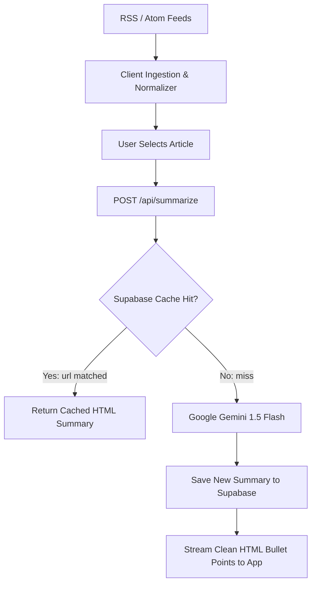

# RSSMindly — AI-Curated RSS Reader & Smart Digest

A cross-platform RSS intelligence reader built with **React**, **Capacitor (Android)**, and **Google Gemini 1.5 Flash**. RSSMindly aggregates multiple news feeds, filters noise, and produces concise bullet summaries backed by a persistent Supabase cache to minimize LLM latency and costs.

---

## Core Engineering Highlights

- **Smart Semantic Caching Layer:** Before calling Gemini 1.5 Flash, the backend queries a Supabase `summaries` table using unique article URLs. Repeated requests or shared articles among users result in immediate cache hits ($O(1)$ lookup, \$0 API cost).
- **Dual Platform (Web & Android Native):** Built using Capacitor 7 to bundle the responsive React/Tailwind frontend into a native Android APK without rewriting business logic.
- **Noise Reduction & Feed Aggregation:** Pulls heterogeneous RSS/Atom feeds, normalizes publication metadata, and groups content into structured categories for rapid scanning.
- **Serverless Edge Function:** Decoupled Vercel serverless function (`/api/summarize`) handling CORS, prompt framing, and secure database interactions.

---

## System Flow



---

## Tech Stack

- **Frontend:** React 19, Vite, Tailwind CSS, Lucide Icons
- **Mobile Runtime:** Capacitor 7 (`@capacitor/android`)
- **AI Engine:** Google Gemini 1.5 Flash (`@google/generative-ai`)
- **Cache & Persistence:** Supabase Database (`@supabase/supabase-js`)
- **Deployment:** Vercel Serverless Functions

---

## Getting Started

### 1. Installation

```bash
git clone https://github.com/mmkaya-ui/rssmindly.git
cd rssmindly
npm install
```

### 2. Environment Variables

Configure your credentials in `.env` (or Vercel environment dashboard):

```bash
GOOGLE_GEMINI_API_KEY=your_gemini_api_key
SUPABASE_URL=your_supabase_url
SUPABASE_KEY=your_supabase_service_or_anon_key
```

### 3. Run Locally

```bash
npm run dev
```

### 4. Build for Android

```bash
npm run build
npx cap sync
npx cap open android
```
