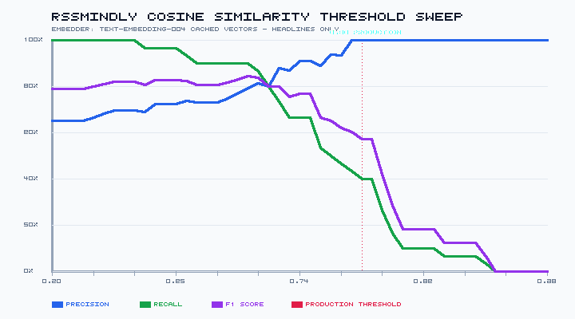

# RSSMindly — Evaluation Results

*Generated by `npm run eval` on 2026-10-15T11:35:16.682Z. Every number below is printed by a script in `evals/`; labels say whether it is measured, simulated, or modelled.*

| Section | What is real | What is not |
|---|---|---|
| 1. Threshold sweep | The sweep logic and the labels | Similarities (simulated embedder) |
| 2. Groundedness | Production `evaluateGroundedness` run on fixed cases | Cases are AI-authored; dev set was used for tuning |
| 3. Replay | Tier 1 latency, cache logic | Tier 2/3 latency (sleep), token counts (constants), hit/miss (simulated embedder) |

---

## 1. Cosine threshold sweep (dedup quality)

> [!WARNING]
> **The similarities in this section come from a simulated embedder** (`evals/lib/semantic_embedder.js`): hand-written regex rules authored while looking at this same dataset. They say nothing about how `text-embedding-004` scores these pairs. To get real numbers, run `GOOGLE_GEMINI_API_KEY=... node evals/embed_pairs.js` once and commit `evals/data/pair_embeddings.json`; the sweep then uses those cached vectors offline.

Dataset: `evals/data/pairs.jsonl`, 60 pairs (30 duplicates, 30 non-duplicates). **All 60 are AI-authored** (`synthetic: true`); 39 paraphrase a real news event (`based_on_real_event: true`), none are copied from a published headline. Awaiting human review.

Embedder: SIMULATED rule-based embedder (evals/lib/semantic_embedder.js) — tuned on this dataset, not representative of text-embedding-004

| Threshold | Precision | Recall | F1 | TP | FP | TN | FN | Notes |
|---|---|---|---|---|---|---|---|---|
| 0.80 | 100.0% | 70.0% | 82.4% | 21 | 0 | 30 | 9 | peak F1 |
| 0.81 | 100.0% | 70.0% | 82.4% | 21 | 0 | 30 | 9 |  |
| 0.82 | 100.0% | 66.7% | 80.0% | 20 | 0 | 30 | 10 |  |
| 0.83 | 100.0% | 63.3% | 77.6% | 19 | 0 | 30 | 11 |  |
| 0.84 | 100.0% | 63.3% | 77.6% | 19 | 0 | 30 | 11 |  |
| 0.85 | 100.0% | 63.3% | 77.6% | 19 | 0 | 30 | 11 |  |
| 0.86 | 100.0% | 63.3% | 77.6% | 19 | 0 | 30 | 11 |  |
| 0.87 | 100.0% | 63.3% | 77.6% | 19 | 0 | 30 | 11 |  |
| 0.88 | 100.0% | 63.3% | 77.6% | 19 | 0 | 30 | 11 |  |
| 0.89 | 100.0% | 63.3% | 77.6% | 19 | 0 | 30 | 11 |  |
| 0.90 | 100.0% | 60.0% | 75.0% | 18 | 0 | 30 | 12 |  |
| 0.91 | 100.0% | 60.0% | 75.0% | 18 | 0 | 30 | 12 |  |
| 0.92 | 100.0% | 50.0% | 66.7% | 15 | 0 | 30 | 15 | production |
| 0.93 | 100.0% | 50.0% | 66.7% | 15 | 0 | 30 | 15 |  |
| 0.94 | 100.0% | 46.7% | 63.6% | 14 | 0 | 30 | 16 |  |
| 0.95 | 100.0% | 46.7% | 63.6% | 14 | 0 | 30 | 16 |  |
| 0.96 | 100.0% | 46.7% | 63.6% | 14 | 0 | 30 | 16 |  |
| 0.97 | 100.0% | 46.7% | 63.6% | 14 | 0 | 30 | 16 |  |
| 0.98 | 100.0% | 46.7% | 63.6% | 14 | 0 | 30 | 16 |  |

### Verdict on 0.92 (computed, not hand-written)
- Peak F1 is 82.4% at 0.8. At 0.92: precision 100%, recall 50%, F1 66.7%.
- 0.92 is dominated on this dataset: 0.81 has the same or better precision (100%) and higher recall (70%). The data does not support 0.92 as the best choice.
- Classes overlap: lowest-scoring duplicate 0.0352 ([p30]) < highest-scoring non-duplicate 0.7356 ([n06]). No threshold is perfect.
- These similarities come from a simulated embedder written against this same dataset. Treat the whole sweep as a harness smoke test, not as evidence for or against 0.92.

---

## 2. Deterministic groundedness

- **Dev set**: 30 cases in `evals/eval_groundedness.js`. `groundedness.js` was changed until these passed, so the current score is optimistic by construction.
- **Held-out set**: 20 cases in `evals/data/groundedness_heldout.json`, labelled by ground truth before running and frozen. **This is the honest estimate.**
- **Baseline**: `api/lib/groundedness.js` before this work (commit a969d44), frozen at `evals/baseline/groundedness_v0.js`.
- All cases are AI-authored. "Positive" = hallucinated summary correctly flagged.

| Set / code | Cases | TP | TN | FP | FN | Accuracy | Precision | Recall |
|---|---|---|---|---|---|---|---|---|
| Dev / baseline | 30 | 14 | 11 | 3 | 2 | 83.3% | 82.4% | 87.5% |
| Dev / current (tuned) | 30 | 16 | 14 | 0 | 0 | 100% | 100% | 100% |
| Held-out / baseline | 20 | 7 | 5 | 3 | 5 | 60% | 70% | 58.3% |
| **Held-out / current** | 20 | 5 | 5 | 3 | 7 | 50% | 62.5% | 41.7% |

### Dev set errors, baseline code (what the fixes addressed)
- **FP [g07]** clean_grounded: Correct investment figure $30 billion and named sponsors. Flagged: `Capital`
- **FP [g26]** formatting_edge_case: Percentage representation: source has "42 percent" while summary has "42%". Flagged: `Clean`
- **FP [g27]** formatting_edge_case: Currency symbol: source has "500 million euros", summary has "€500 million". Flagged: `€500 million`
- **FN [g28]** single_digit_hallucination: Single digit hallucination: source has "2", summary invents "8"
- **FN [g29]** split_name_coincidence: Entity recombination: "John" from John Higgins + "Smith" from Michael Smith = fake entity "John Smith"

### Held-out errors, current code
- **FP [h07]** rounding: Hedged rounding; judged faithful. Flagged: `1,600`
- **FP [h08]** spelled_number: Word number in source, digit in summary. Flagged: `3`
- **FP [h15]** multiword_entity: Inferable title merged into one capitalised span. Flagged: `Federal Reserve Chair Jerome Powell`
- **FN [h04]** swapped_attribution: Both numbers exist in source but are attached to the wrong metric
- **FN [h05]** negation: Polarity flipped; no numbers or new entities
- **FN [h06]** stopword_entity: Invented person whose surname is in STOPWORDS ('Price')
- **FN [h10]** wrong_year: Year changed
- **FN [h11]** substring_number: Wrong number that is a substring of the right one
- **FN [h14]** swapped_roles: Same entities and number, roles reversed
- **FN [h18]** wrong_currency: Currency changed, amount kept

### Held-out errors, baseline code
- **FP [h07]** rounding: Hedged rounding; judged faithful. Flagged: `1,600`
- **FP [h09]** abbreviation: billion -> B. Flagged: `$5.2B`
- **FP [h15]** multiword_entity: Inferable title merged into one capitalised span. Flagged: `Federal Reserve Chair Jerome Powell`
- **FN [h04]** swapped_attribution: Both numbers exist in source but are attached to the wrong metric
- **FN [h05]** negation: Polarity flipped; no numbers or new entities
- **FN [h10]** wrong_year: Year changed
- **FN [h11]** substring_number: Wrong number that is a substring of the right one
- **FN [h14]** swapped_roles: Same entities and number, roles reversed

---

## 3. Feed replay (mocked Gemini + Supabase)

Replays `evals/data/feed_fixture.json` (20 AI-authored articles) through the pipeline logic. Hit/miss decisions use the **simulated** embedder.

| Tier | Latency | Status |
|---|---|---|
| Tier 1 extractive | 0.056 ms | **Measured** (production code, Node, one machine) |
| Exact URL hit | 0.03 ms | In-memory Map, not Supabase; not representative |
| Semantic hit | 42.6 ms | **Simulated** (`sleep(42)`) |
| Miss (generation) | 240.5 ms | **Simulated** (`sleep(240)`) |
| Tier 3 | 420.1 ms | **Simulated** (`sleep(420)`) |

- Cache hits: **5/20** (25%): 4 semantic, 1 exact, 15 misses.
- Tier 2 tokens saved: **22.7%**, *modelled* with fixed constants (380 generation + 40 embedding tokens per call): consumed 6460, saved 1900.

---

## 4. Cost per 1,000 summaries (input side)

Measured from the exact prompt `buildTier2Prompt` produces; tokens estimated as chars/4 (rule of thumb, not a tokenizer count). No prices are hard-coded: run `evals/estimate_cost.js` with your current prices to get a dollar figure.

| Prompt | Chars | Est. input tokens |
|---|---|---|
| Fixture average (short AI-authored articles) | 570 | 143 |
| Upper bound (500-char title, 4,000-char content cap) | 4856 | 1214 |

Formula: `cost_per_1k = 1000 × (1 − hit_rate) × (in_tokens × price_in + out_tokens × price_out) / 1e6`. Output tokens and the real hit rate are not measured here.

---

## Regression floors (CI)
`npm run eval` exits non-zero if any of these drop: `groundednessDevAccuracy >= 100`, `groundednessHeldoutAccuracy >= 50`, `groundednessHeldoutRecall >= 41.7`, `replayCacheHits >= 5`.
